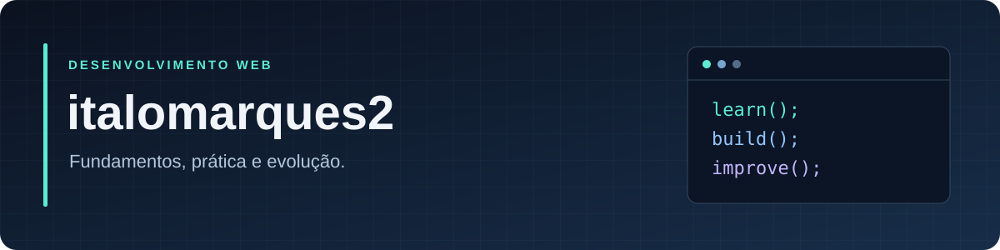
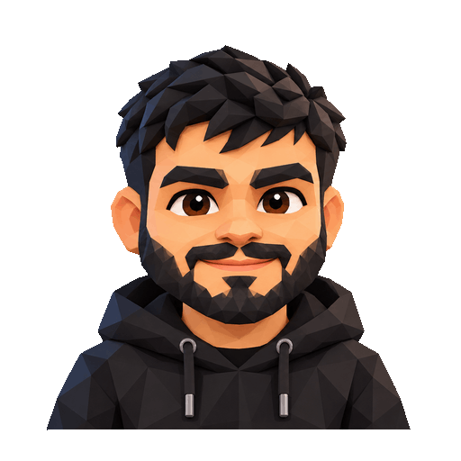
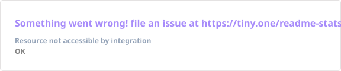
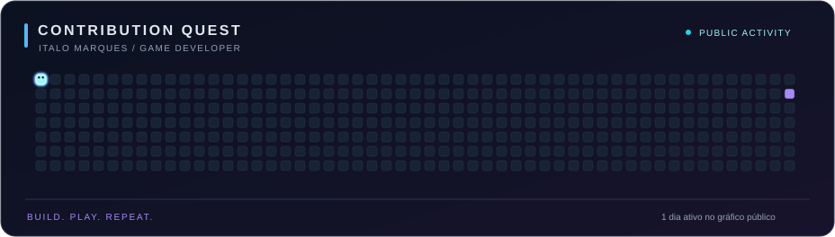

  

# Olá, eu sou o Italo Marques 👋

**Game Developer · Artista 3D · Three.js em estudo**

Sou **Game Developer e artista 3D**. Estou ampliando minha atuação para o **desenvolvimento web** e estudando **Three.js** para conectar criação visual, jogos e experiências interativas no navegador.

### 🧊 Sobre mim

- Atuo com desenvolvimento de jogos, projetos 3D, modelagem e animação.
- Estudo a construção de cenas, geometrias, materiais, iluminação e interação com Three.js.
- Quero aproximar criação visual e programação, transformando cenas em experiências que as pessoas possam explorar.
- Continuo minha formação em desenvolvimento web, aplicando os fundamentos em estudos e projetos.

### 🛠️ Tecnologias e prática

Minha base está na criação 3D. Estas são as tecnologias que estou estudando e aplicando na evolução para a web:

  
  
  
  
  
  

| Área | Foco |
| --- | --- |
| **Game Development** | Criação de jogos e experiências interativas. |
| **Base artística** | Criação 3D, modelagem, composição visual e animação. |
| **Estudos de 3D na web** | Three.js, WebGL, geometrias, materiais e iluminação. |
| **Movimento e interação** | Estudos de animação, hierarquia de objetos e controles de câmera. |
| **Desenvolvimento web** | JavaScript, HTML, CSS e Git. |

### 🔒 Projetos e portfólio

Parte dos meus projetos 3D tem restrições de divulgação por direitos autorais. Por isso, nem todo o trabalho que desenvolvo pode aparecer em repositórios públicos.

Meu objetivo aqui é compartilhar estudos, experimentos próprios e soluções que eu possa disponibilizar, documentando o processo e as decisões técnicas.

### 📂 Código público

| Repositório | O que você encontra |
| --- | --- |
| [Web Development Lab](https://github.com/italomarques2/web-development-lab) | Formação complementar em desenvolvimento web: exercícios explicados, callbacks e testes automatizados. |

### 📊 Atividade pública no GitHub

  
  

Os gráficos refletem apenas os repositórios e a atividade públicos no GitHub.

### 🕹️ Contribution Quest

  

### 🤝 Vamos nos conectar

